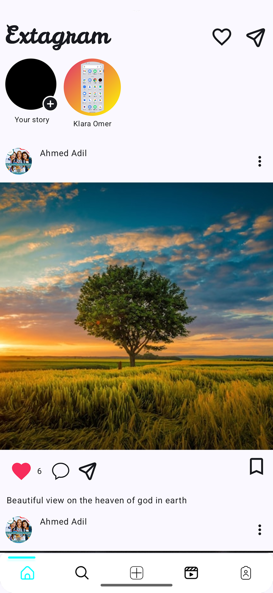
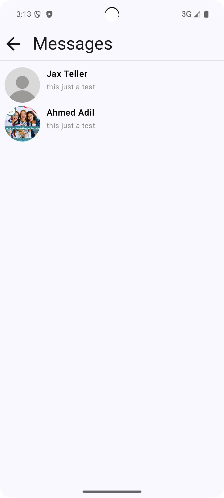
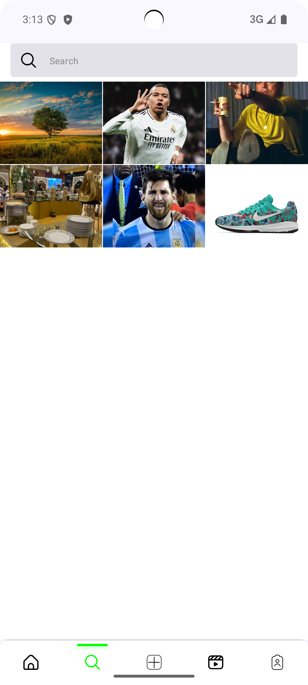
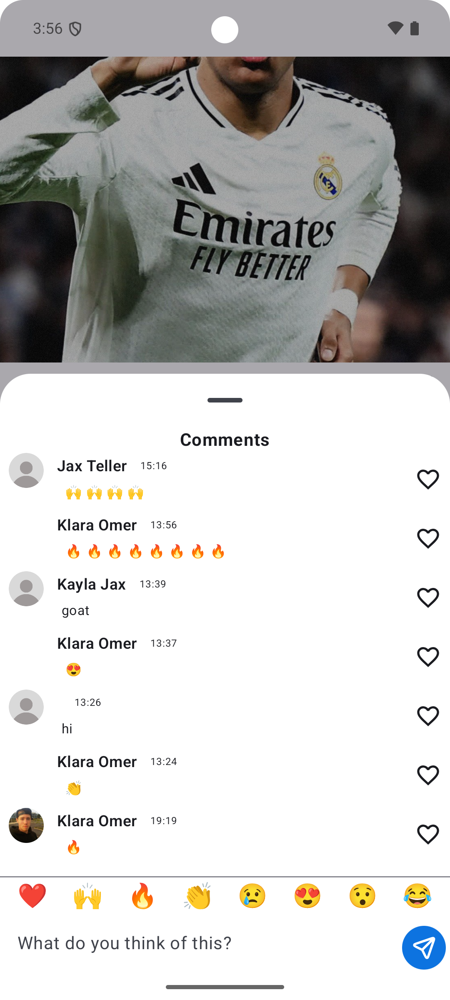
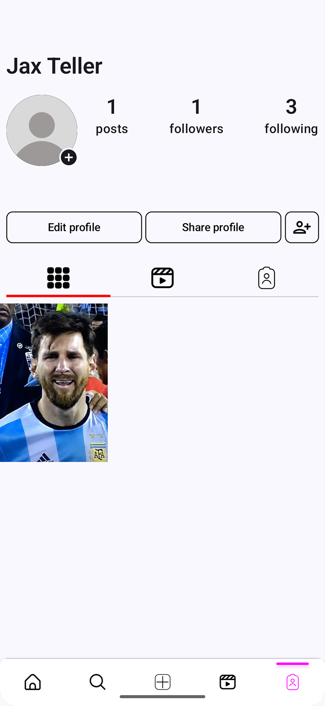

# 📸 Instagram Clone — Native Android App

A feature-rich, full-stack Android social media application built with **100% Kotlin** and **Jetpack Compose**. The project strictly adheres to **Clean Architecture** and **MVVM/MVI** design patterns, utilizing **Dagger Hilt** for dependency injection and **Firebase** as a hybrid backend for real-time social networking, video streaming, and direct messaging.

---

## 📌 Project Overview

This project is an open-source, production-ready clone of Instagram designed to showcase modern Android development best practices. It features a declarative Jetpack Compose UI with custom Material 3 components, real-time 1-on-1 direct messaging, short-form video Reels streaming powered by **AndroidX Media3 ExoPlayer**, ephemeral video stories, image post creation, and comprehensive profile management.

---

## ✨ Features (Verified & Implemented)

### 🔐 1. Authentication & Onboarding
- **Account Registration & Login:** User sign-up with email, password, first name, last name, and username.
- **Form Validation:** Client-side validation for email formatting and password strength (`util/RegisterValidation.kt`).
- **Session Management:** Auth persistence via **Firebase Authentication**.

### 📰 2. Home Feed & Social Interactions
- **Real-Time Post Feed:** Dynamic home feed displaying user posts sorted chronologically with author profile metadata.
- **Liking & Unliking:** Interactive post likes backed by Firebase Firestore array updates.
- **Comments System:** Real-time comment drawer/view for posts with user avatar support.
- **Stories Bar:** Interactive top stories tray displaying followers' ephemeral video stories.

### 🎥 3. Short Video Reels
- **Video Streaming Feed:** Short video feed built using **AndroidX Media3 ExoPlayer**.
- **Lifecycle-Aware Playback:** Auto-play, pause, and resource cleanup managed according to screen lifecycle.

### 💬 4. Real-Time Direct Messaging (DMs)
- **Instant 1-on-1 Chat:** Low-latency chat messaging powered by **Firebase Realtime Database**.
- **Chat Conversations List:** Recent chats dashboard displaying senders and real-time last message previews.
- **Message Ownership:** Distinct UI bubbles for incoming vs. outgoing messages.

### ⭕ 5. Ephemeral Stories
- **Story Creation:** Upload video stories directly to Cloud Storage.
- **Story Viewer:** Story playback player for viewing followers' active stories.

### 👤 6. User Profile & Discovery
- **Profile Dashboard:** Displays user stats (Posts count, Followers, Following), profile bio, and a grid of published posts.
- **Edit Profile:** Update personal details and upload a new profile picture to Firebase Storage.
- **Follow / Unfollow Engine:** Atomic Firebase batch updates for mutual follower and following counts.
- **User Search & Explore:** Search users by name or username with real-time Firestore query filtering.

---

## 🛠 Tech Stack

| Category | Technology / Library |
| :--- | :--- |
| **Language** | Kotlin 2.0+ (100% Idiomatic Kotlin) |
| **UI Framework** | Jetpack Compose (Declarative UI) |
| **Design System** | Material 3 + Custom Animated Navigation Indicators |
| **Architecture** | Clean Architecture (Data, Domain, Presentation) + MVVM / MVI |
| **Dependency Injection** | Dagger Hilt |
| **Async & Reactive** | Kotlin Coroutines & `StateFlow` / `callbackFlow` |
| **Backend & Cloud** | Firebase Authentication, Cloud Firestore, Firebase Realtime DB, Firebase Storage |
| **Video Playback** | AndroidX Media3 ExoPlayer |
| **Image Loading** | Coil Compose |
| **Navigation** | Jetpack Navigation Compose |

---

## 🏗 Architecture

The codebase is organized following **Clean Architecture** principles to separate concerns into three core layers:

```text
com.ahmed.instagramclone/
├── data/
│   ├── repository/        # Concrete Repository implementations (Firebase Firestore, Storage, Realtime DB)
├── di/                    # Dagger Hilt Dependency Injection Modules (AppModule, PostModule)
├── domain/
│   ├── model/             # Domain data models (User, Post, Comment, Message, Story, Reel)
│   ├── repository/        # Abstract Repository Interfaces
│   └── usecases/          # Single-responsibility Use Cases (Auth, Posts, Chat, User, Stories, Reels)
├── presentation/          # Jetpack Compose UI Screens, ViewModels & UI Events
│   ├── appnav/            # Navigation bar & root container
│   ├── chat/              # Real-time chat screen
│   ├── comments/          # Comments sheet & screen
│   ├── edit/              # Edit profile screen
│   ├── explore/           # Explore screen
│   ├── followers/         # Followers / Following list
│   ├── home/              # Main feed screen
│   ├── login/ & register/ # Auth screens
│   ├── messages/          # DMs conversation list
│   ├── new_post/          # New post creation screen
│   ├── profile/ & user/   # Profile screens
│   ├── reels/             # ExoPlayer short video feed
│   └── story/             # Story creation & viewer
└── util/                  # Constants, Dimens, Resource state wrapper, Validation helpers
```

### Architectural Highlights:
1. **Domain Use Cases:** Business logic is encapsulated in isolated Use Cases (`UploadPost`, `SendMessage`, `FollowUser`, `GetReels`, `GetComments`), making the domain layer completely independent of frameworks or backends.
2. **State Management:** ViewModels expose UI state using Kotlin `StateFlow` and accept UI actions via sealed `Event` classes (MVI pattern).
3. **Data Flow:** Repositories use `flow` and `callbackFlow` to convert Firebase listeners into reactive streams consumed by ViewModels.

---

## 📸 Screenshots

| Home Feed | Reels Video | User Search |
| :---: | :---: | :---: |
|  |  |  |

| Explore Screen | Comments | Profile |
| :---: | :---: | :---: |
|  |  |  |

---

## 📋 Requirements

- **Android Studio:** Ladybug (2024.2.1) or newer recommended
- **Minimum SDK:** API 29 (Android 10)
- **Target SDK:** API 35 (Android 15)
- **Java / JDK Version:** JDK 11
- **Google Services:** Configured `google-services.json` file for Firebase integration.

---

## 🚀 Installation & Setup

1. **Clone the Repository:**
   ```bash
   git clone https://github.com/your-username/SocialMediaApp.git
   cd SocialMediaApp
   ```

2. **Set Up Firebase Project:**
   - Create a project on the [Firebase Console](https://console.firebase.google.com/).
   - Enable **Firebase Authentication** (Email/Password).
   - Enable **Cloud Firestore** and **Firebase Realtime Database**.
   - Enable **Firebase Storage**.
   - Download `google-services.json` and place it in the `app/` directory:
     ```
     SocialMediaApp/app/google-services.json
     ```

3. **Open & Build Project:**
   - Open the project in **Android Studio**.
   - Let Gradle sync dependencies.
   - Run the `:app` configuration on an Android Emulator or physical device (Android 10+).

---

## 🔮 Future Improvements

- [ ] **Push Notifications:** Integrate Firebase Cloud Messaging (FCM) for real-time message and post notifications.
- [ ] **Offline Caching:** Implement Room Database for offline post caching and draft saving.
- [ ] **Multi-Image Posts:** Support carousel image uploads per post.
- [ ] **Video Upload Compression:** Client-side video encoding before uploading stories and reels.
- [ ] **Unit & UI Test Coverage:** Expand test coverage using MockK, Turbine, and Compose UI Test Framework.

---

## 📄 License

Distributed under the MIT License. See `LICENSE` for more information.
